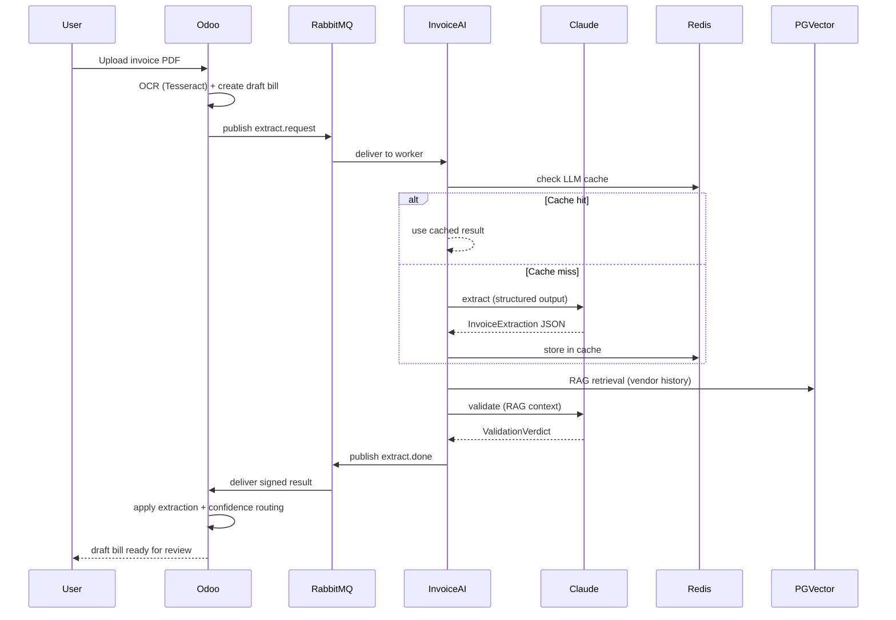

# Invoice Agent — AI-Powered Vendor Invoice Extraction

> **OCR → Claude structured extraction → RAG validation → draft `account.move`**

An Odoo 19 addon that automates vendor invoice data entry. Upload a scanned PDF and the pipeline extracts structured fields (vendor, dates, line items, amounts) using Tesseract OCR + Claude AI, validates the result against the vendor's posting history via pgvector RAG, and produces a draft bill routed by confidence score — no manual typing required.


## Architecture



### Key Design Decisions

| Decision | Rationale |
|----------|-----------|
| **Separate FastAPI service** (ADR-003) | LLM round-trips (5-20s) would pin Odoo HTTP workers — measured 33.5× degradation with workers=2 |
| **RabbitMQ + transactional outbox** (ADR-004) | Guarantees no lost jobs even if the broker restarts mid-request |
| **Claude structured output** | Schema-validated extraction eliminates JSON parsing errors |
| **RAG validation** (Phase 2) | Second Claude call with vendor history catches misclassifications before the accountant sees them |
| **Confidence-based routing** | Auto-fill (≥90%), review (≥70%), or human (<70%) — three-tier kanban |

## Quickstart

```bash
# 1. Clone and configure
git clone https://github.com/7ananSaif/odoo.git
cd odoo
cp .env.example .env   # fill in ANTHROPIC_API_KEY, JWT_SECRET

# 2. Start the stack
docker compose up -d

# 3. Open Odoo (default: admin/admin)
# http://localhost:8069 → Invoicing → Vendors → Bills → Upload

# 4. Upload a scanned invoice PDF
# Watch the extraction status: pending → processing → extracted
# Review the AI-suggested fields in the suggestion panel
```

## Three ways to run this

The application is identical in all three; what changes is where it runs and what
you pay. Pick one.

| | `full-infra/` | `lite-infra/` | `k8s-local/` |
|---|---|---|---|
| Orchestrator | EKS | Docker Compose on one box | laptop Kubernetes |
| Database | RDS | Postgres container + volume | Postgres StatefulSet + PVC |
| Cost | $$$ (EKS + ALB + NAT + RDS) | **≈$5.10/month** | $0 |
| Purpose | production-shaped reference | cheapest thing that really works | iterate without a cloud bill |

### Option 1 — `full-infra` (EKS + RDS, the production-shaped stack)

Terraform for the AWS layer, Helm for the workload, eksctl for the cluster.

```bash
# 1. Infrastructure: VPC, RDS, ElastiCache, S3, IAM, security groups
cd full-infra/terraform
terraform init
terraform plan  -out=tfplan
terraform apply tfplan

# Subnet/KMS/secret ARNs feed the cluster manifest:
terraform output

# 2. Cluster (substitute the real subnet IDs in the manifest first)
eksctl create cluster -f ../eks/cluster.yaml

# 3. Workload
helm upgrade --install odoo ../helm/odoo-stack \
  -f ../helm/odoo-stack/values.production.yaml \
  --namespace odoo --create-namespace --wait

# 4. Operator runbook (upgrades, restores, rotation)
#    full-infra/runbook.md
```

The ALB terminates TLS and fronts Odoo; RDS is the database; secrets come from
AWS Secrets Manager through External Secrets. Full details:
[`full-infra/runbook.md`](full-infra/runbook.md).

### Option 2 — `lite-infra` (one $5/month Lightsail instance)

One instance, Docker Compose, its own Postgres. No EKS, no ALB, no NAT, no RDS.

```bash
# 1. Configure
cd lite-infra
cp terraform.tfvars.example terraform.tfvars
#    set billing_alarm_email, ssh_allowed_cidrs (your IP), db_password

# 2. Create the instance (+ static IP, firewall, $5 billing alarm)
terraform init
terraform apply

# 3. Watch first boot (installs Docker, builds the image: 30-60 min cold)
terraform output -raw ssh_private_key > lite-infra-key.pem
chmod 600 lite-infra-key.pem
bash ../deploy/lite-aws.sh logs

# 4. Open it
terraform output app_url        # http://<static-ip>/web/login

# 5. Tear down (DESTRUCTIVE - deletes the database with the instance)
bash ../deploy/lite-aws.sh snapshot
bash ../deploy/lite-aws.sh down
```

Or the wrapper for steps 2-4: `bash deploy/lite-aws.sh up`. Cost breakdown,
caveats (512 MB + 2 GB swap, the AI pipeline does **not** fit here) and pricing
sources: [`lite-infra/README.md`](lite-infra/README.md).

### Option 3 — `k8s-local` (Docker Desktop Kubernetes or kind)

Odoo + Postgres on your machine, with a real PersistentVolume so the database
survives restarts. No cloud account needed.

```bash
# 0. Prerequisites: Docker Desktop with Kubernetes enabled, kubectl.
#    (or: kind installed, and use CLUSTER=kind below)

# 1. Build the image and check the cluster
cd k8s-local
make k8s-up                 # no make? bash ../deploy/local-k8s.sh up

# 2. Apply, wait for Postgres, initialise the schema, wait for Odoo
make k8s-deploy             # bash ../deploy/local-k8s.sh deploy

# 3. Open it
#    Docker Desktop: http://localhost:30080
#    kind:           http://localhost:8081
#    either:         kubectl port-forward -n odoo-local svc/odoo 8069:8069

# 4. Day-to-day
make logs       # follow Odoo
make db-shell   # psql
make db-backup  # pg_dump -Fc into ./backups
make k8s-down   # stop, KEEP data
make k8s-destroy  # delete namespace + volumes (asks 'yes')
```

On kind, pass the cluster on both commands — `make k8s-up CLUSTER=kind` then
`make k8s-deploy CLUSTER=kind` — or use the script, which takes it as an
argument: `bash deploy/local-k8s.sh up kind`. Full command reference,
data-survival table and troubleshooting:
[`k8s-local/README.md`](k8s-local/README.md).

### Services

| Service | Port | Purpose |
|---------|------|---------|
| Odoo | 8069 (loopback) | ERP + UI + outbox drain |
| invoice-ai | 8100 | FastAPI: OCR → Claude → RAG |
| worker | — | AMQP consumer (Claude calls) |
| RabbitMQ | 15672 (loopback) | Job queue + management UI |
| PostgreSQL | 5434 (loopback) | Database + pgvector |
| Redis | 6379 (loopback) | LLM cache + sessions |
| nginx | 80/443 | Reverse proxy + TLS |

## Configuration

| Variable | Default | Purpose |
|----------|---------|---------|
| `ANTHROPIC_API_KEY` | (required) | Claude API key |
| `INVOICE_AI_JWT_SECRET` | (required) | Shared JWT secret between Odoo ↔ invoice-ai |
| `REDIS_URL` | `redis://localhost:6379/0` | LLM extraction cache (7-day TTL) |
| `RABBITMQ_HOST` | `rabbitmq` | Job queue broker |
| `POSTGRES_DB` | `postgres` | Database name |
| `POSTGRES_PASSWORD` | `odoo` | Database password |
| `URL` | — | Public base URL for `web.base.url` |

## Load Testing

```bash
# Generate test invoice PDFs
pip install reportlab
python scripts/generate_test_invoices.py --count 10

# Smoke test (5 users, 2 min)
cd invoice-ai
LOCUST_JWT_SECRET=your-secret locust --headless -u 5 -r 1 --run-time 2m

# Full ramp (100 users, 30 min)
LOCUST_JWT_SECRET=your-secret locust --headless -u 100 -r 2 --run-time 30m \
    --csv=results/ramp --html=results/ramp-report.html
```

See [docs/load-test.md](docs/load-test.md) for the capacity report and cost model.

## Cost per Invoice

| Component | Cost per 1,000 invoices |
|-----------|------------------------|
| Claude API (Opus 4, cached) | $71 |
| Claude API (with RAG validation) | $109 |
| Infrastructure (prorated) | $19 |
| **Total (extraction only)** | **$90** |
| **Total (with RAG)** | **$128** |

## Project Structure

```
├── custom_addons/
│   ├── invoice_agent/       # Main Odoo addon (account.move AI fields, outbox, UI)
│   ├── s3_storage/          # S3 filestore override
│   └── session_redis/       # Redis session store
├── invoice-ai/
│   ├── app/
│   │   ├── main.py          # FastAPI service (/v1/extract, /v1/embed, /rag/vendor-context)
│   │   ├── consumer.py      # AMQP worker (Claude calls + RAG validation)
│   │   ├── claude.py        # AsyncAnthropic client with prompt caching
│   │   ├── schemas.py       # InvoiceExtraction Pydantic schema
│   │   ├── validate.py      # RAG validation (account routing + duplicate detection)
│   │   ├── retrieve.py      # Hybrid vector + ref + VAT retrieval (pgvector)
│   │   ├── embeddings.py    # Voyage-3 embedding client
│   │   └── metrics.py       # Prometheus metrics (RED method)
│   ├── locustfile.py        # Load test (Locust)
│   └── pyproject.toml       # Dependencies + tooling
├── full-infra/              # Option 1: EKS + RDS (the production-shaped stack)
│   ├── terraform/           # IaC: VPC, RDS, S3, Redis, security groups
│   ├── helm/odoo-stack/     # the workload
│   ├── eks/                 # eksctl cluster manifest, ALB controller notes
│   └── observability/       # Prometheus + Grafana + Alertmanager
├── lite-infra/              # Option 2: one Lightsail instance, Docker Compose, $5/month
│   ├── *.tf                 # instance, static IP, firewall, $5 billing alarm
│   ├── docker-compose.lite.yml
│   └── boot.sh.tftpl        # cloud-init: docker + compose + schema init
├── k8s-local/               # Option 3: Docker Desktop K8s or kind, PV-backed Postgres
│   ├── base/                # kustomize manifests (namespace, deploy, svc, sts, pvc, job)
│   └── Makefile             # k8s-up / k8s-deploy / k8s-down / db-shell / db-backup / logs
├── deploy/                  # wrappers: local-k8s.sh, lite-aws.sh
├── infra-v1-backup/         # untouched pre-rename snapshot of ./infra (tag: infra-v1)
├── docs/
│   ├── architecture.md      # Full architecture with network topology
│   ├── load-test.md         # Capacity report
│   └── runbooks/            # Operational runbooks
└── docker-compose.yml       # Local development stack
```

## API Endpoints

| Method | Path | Auth | Rate Limit | Purpose |
|--------|------|------|------------|---------|
| `POST` | `/v1/extract` | JWT | 10/min | Extract invoice data from PDF/image |
| `POST` | `/v1/embed` | JWT | 30/min | Embed documents with Voyage-3 |
| `POST` | `/rag/vendor-context` | JWT | 20/min | Retrieve vendor history for RAG |
| `GET` | `/healthz` | None | — | Liveness probe (returns build SHA) |
| `GET` | `/metrics` | None | — | Prometheus metrics |

## Monitoring

The Grafana SLO dashboard (`full-infra/observability/grafana/dashboards/agent-slo.json`) shows:

- **Pipeline RED**: request rate, error rate, p95 duration
- **Worker & Queue**: job throughput, queue depth, retry rate
- **Infrastructure USE**: CPU, memory, disk, PostgreSQL connections
- **Cost tracking**: daily token consumption, estimated API spend

Key alerts: `PipelineErrorRateHigh`, `PipelineLatencyHigh`, `RDSConnectionsNearCap`, `WorkerQueueBacklog`

## Honest Limitations

- **Requires Anthropic API key** — costs ~$0.07-0.11 per invoice depending on RAG
- **Tesseract OCR accuracy** depends on scan quality — low-DPI or skewed scans degrade extraction
- **RAG needs ≥5 historical bills** per vendor before validation adds value
- **Single-tenant** — no multi-company isolation yet
- **Claude rate limits** — the RPM cap (100 on Build tier) bounds throughput at ~100 invoices/minute with full caching
- **No real-time streaming** — the extraction result arrives via RabbitMQ polling, not WebSocket

## License

[LGPL-3](LICENSE) — compatible with Odoo Community addons.

## Contributing

See [CONTRIBUTING.md](CONTRIBUTING.md) for PR workflow, code style, and testing requirements.
